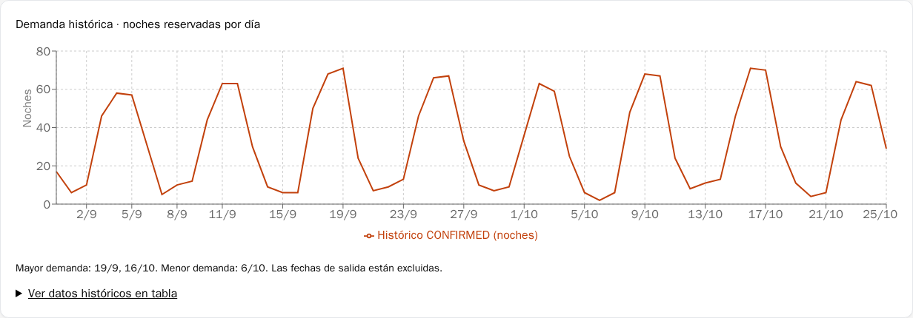
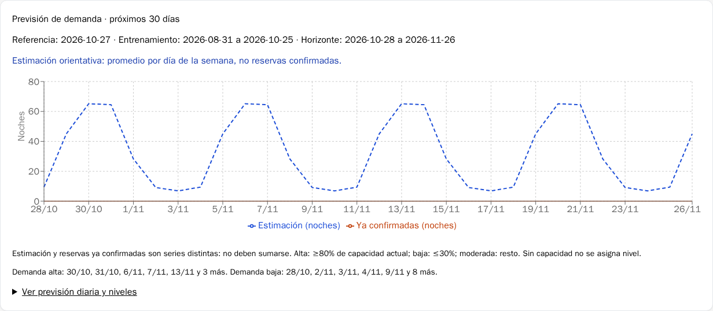

# HU-03: historial académico reproducible

## Diagnóstico y ejecución real — 27/10/2026

Antes de intervenir, `hotel-bd` tenía 13 hoteles, 72 habitaciones activas y una
reserva confirmada del 26 al 27 de octubre. No tenía actividad en las ocho
semanas completas de entrenamiento. La fórmula funcionaba correctamente y
**no fue modificada**. El reloj del backend usa `America/Panama`.

Con autorización expresa del operador, se creó un respaldo privado custom de
PostgreSQL, se verificó su SHA-256 y se restauró en una base temporal aislada.
V3 se probó allí antes de aplicarla a desarrollo. Las huellas de cada fila de las
seis tablas originales permanecieron idénticas después de migrar y cargar datos.
V1/V2 y el baseline existente no se alteraron ni repitieron. Los respaldos,
credenciales y huellas privadas permanecen bajo `.local/`, excluido de Git.

Se ejecutó el lote `hu03-panama-history-v1`, referencia **2026-10-27**, semilla
**73003**, doce semanas completas **2026-08-03 a 2026-10-25**:

| Resultado | Cantidad |
|---|---:|
| Reservas sintéticas | 936 |
| CONFIRMED | 854 |
| CANCELLED | 82 |
| Noches confirmadas, doce semanas | 2779 |
| Hoteles / habitaciones utilizados | 12 / 72 |
| Máximo diario sintético de habitaciones comprometidas | 71 |
| Solapamientos CONFIRMED, incluidos registros anteriores | 0 |
| Fechas, precios o cronología incoherentes | 0 |
| Filas originales modificadas | 0 |

Una segunda ejecución devolvió `reused=true`, las mismas 936 reservas y cero
filas del lote modificadas. No creó otra cuenta ni duplicó reservas.

## Generación y seguimiento

`DemandHistoryBatchService` solamente se invoca mediante el perfil explícito
`demand-history`; no se ejecuta durante el arranque normal ni tiene endpoint HTTP.
Exige destino exacto, confirmación, perfil no productivo y respaldo verificado en
desarrollo. El script admite únicamente el datasource esperado de `hotel-bd`.

V3 añade `reservation_demo_batches` y `reservation_demo_items`: UUID de lote,
código único, algoritmo `WEEKEND_HISTORY_V1`, fecha, semilla, período, propietario
técnico, estado y huellas de las filas creadas. Cada reserva tiene una asociación
única al lote y una clave de escenario. No se reutilizan campos de negocio para
esconder etiquetas. El lote revertido conserva metadatos de auditoría.

La cuenta nueva `hu03-data-…` tiene rol **USER**, correo `example.invalid` y una
contraseña aleatoria BCrypt que no se entrega ni conserva. No se usan cuentas
personales. Su fecha ficticia de creación precede las reservas sintéticas.

El generador selecciona hasta seis habitaciones activas por hotel, máximo 72;
no cambia habitaciones ni hoteles. Usa `Random(seed XOR referenceDate.toEpochDay())`,
orden estable por hotel/habitación y doce semanas por defecto (admite 8–16).
Las estancias principales duran 1–5 noches, algunas siete; predominan jueves,
viernes y sábado, con variación semanal y algunas estancias laborales y canceladas.
Las fechas de creación preceden la entrada, y la cancelación queda entre ambas.
La tarifa pactada es el precio educativo actual de la habitación, no una tarifa
comercial histórica real. El total es noches por tarifa.

La generación es transaccional: bloqueo asesor entre comandos y bloqueo de las
habitaciones compatible con las reservas normales; se consultan todos los
intervalos CONFIRMED antes de insertar. Las reservas existentes se preservan.
Se aborta sin lote si no puede generarse actividad confirmada; máximo 1200 filas.
Misma fecha/semilla/inventario e intervalos previos producen el mismo escenario;
los UUID, IDs y contraseñas aleatorias no forman parte de esa reproducibilidad.

## Ejecución explícita

En una instalación con V3 previamente revisada y aplicada, desde PowerShell:

```powershell
# hotel-bd de desarrollo: confirma escrituras y realiza un respaldo privado.
./scripts/Invoke-Hu03History.ps1 -Action Create -ConfirmDataWrites

# Solo lectura; no genera otro respaldo ni modifica datos.
./scripts/Invoke-Hu03History.ps1 -Action Inspect

# Otro escenario: fecha pasada o actual según Panamá, código nuevo obligatorio.
./scripts/Invoke-Hu03History.ps1 -Action Create -BatchCode hu03-otro-escenario-v1 `
  -ReferenceDate 2026-10-27 -Seed 73003 -Weeks 12 -ConfirmDataWrites
```

Omitir `ReferenceDate` calcula la fecha del backend para un lote nuevo; para un
código existente reutiliza su fecha registrada. Cambiar parámetros de un lote
existente se rechaza. La carga nunca sobrescribe cambios manuales.
No ejecutar otro escenario sobre el mismo inventario sin revisar los datos:
el generador respeta lo ya reservado y el escenario puede quedar incompleto.
Los comandos construyen el runner aislado, usan su JAR para mantenimiento
explícito y deshabilitan Flyway en ese proceso; no migran automáticamente desarrollo.
No hay credenciales en argumentos: se transfieren mediante variables privadas del
proceso y se restauran al terminar. No usar trazado de shell ni volcar su entorno.

### Reversión exclusiva, previa confirmación

**No se revirtió el lote de desarrollo.** La reversión se probó en PostgreSQL aislado.
Después de revisar `Inspect`, autorizar explícitamente el código concreto:

```powershell
./scripts/Invoke-Hu03History.ps1 -Action Revert `
  -BatchCode hu03-panama-history-v1 -ConfirmRevertBatch hu03-panama-history-v1 `
  -ConfirmDataWrites
```

Se crea otro respaldo antes de escribir. El servicio bloquea el lote, verifica
cantidad y huellas originales de reservas y usuario técnico, pagos, reseñas,
reservas externas y relaciones desconocidas. Si algo cambió o tiene dependencias,
rechaza toda la transacción. Elimina exclusivamente las reservas enumeradas por
las relaciones del lote y su cuenta técnica; conserva el registro REVERTED.
No usa rangos de IDs ni reinicia secuencias. Un código revertido no se reutiliza:
para regenerar, elegir un código nuevo.

## Fórmula y resultados comprobados

Referencia 2026-10-27: entrenamiento **2026-08-31 a 2026-10-25**, horizonte
**2026-10-28 a 2026-11-26**. Noches por fecha de estancia, entrada inclusiva,
salida exclusiva; CANCELLED no aporta noches. Estos totales son sintéticos:

| Día | Noches en ocho semanas | Observaciones | Previsión diaria |
|---|---:|---:|---:|
| Lunes | 73 | 8 | 9.13 |
| Martes | 55 | 8 | 6.88 |
| Miércoles | 75 | 8 | 9.38 |
| Jueves | 360 | 8 | 45.00 |
| Viernes | 521 | 8 | 65.13 |
| Sábado | 516 | 8 | 64.50 |
| Domingo | 226 | 8 | 28.25 |

Ejemplo independiente SQL/backend: viernes **521 / 8 = 65.125 → 65.13**
con HALF_UP a dos decimales. El 30/10 estima 65.13 noches; referencia de
capacidad **65.13 / 72 × 100 = 90.46%**, demanda alta. El 28/10 estima 9.38,
13.03%, baja; el 29/10, 45.00, 62.50%, moderada. No son reservas futuras.

En la ventana histórica de ocho semanas hay 628 reservas que intersectan el
período: 577 confirmadas, 51 canceladas y **1826 noches**, promedio **32.61**,
referencia de capacidad **45.29%**. Una estancia que cruza el límite del período
se cuenta como reserva una vez y solamente aporta sus noches dentro de él.
La capacidad es la actual, no ocupación efectiva ni capacidad histórica.

Las 30 estimaciones son no negativas y no superan la capacidad actual en este
escenario; el método general no recorta automáticamente predicciones a capacidad.
Los doce filtros con seis habitaciones ofrecen previsión. El hotel preexistente
sin habitaciones conserva `INSUFFICIENT_HISTORY`, sin inventar resultados.

## Origen visible y navegador real

Los contextos de `/api/admin/demand/history` y `/forecast` incorporan
`syntheticReservations`, `operationalReservations`, `syntheticBatches` y
`dataKind`: `OPERATIONAL`, `SYNTHETIC_DEMO` o `MIXED`. Se derivan de las relaciones
reales del lote y del hotel/período consultado, no de un aviso fijo. El modelo
considera entrenamiento y horizonte sin contar dos veces una misma reserva.
La configuración antigua de instancia sintética sigue restringida a hotel_test/demo.

En desarrollo, la ventana predeterminada contiene 628 reservas sintéticas y cero
operativas; otras ventanas pueden incluir la reserva operativa conservada. El
panel distingue ambos orígenes y muestra los códigos de lote, junto a la advertencia
educativa. Los datos catalogados de hoteles/precios continúan siendo demostración.

Chromium verificó la aplicación real en `http://localhost:5173/admin`, con el
hostname localhost resuelto al contenedor Vite dentro de la red de desarrollo;
se usaron su proxy, backend y PostgreSQL reales. El ADMIN temporal fue autorizado
expresamente, tuvo contraseña aleatoria privada, cerró sesión y se eliminó después
de comprobar identidad exacta y ausencia de dependencias. No se usó la cuenta
personal del operador ni se cambiaron roles o contraseñas existentes.

Se comprobaron gráficos, cifras, 30 días, promedios, niveles alto/bajo, todos los
filtros por hotel, móvil de 390 px, sesión persistida y logout invalidado. Sin errores
500, CSRF o JavaScript. Capturas completas y resultados privados:
`.local/private-hu03-history/browser/`; gráficos sin datos personales publicados:




Se detectó además que Vite servía una versión anterior del módulo pese a estar
actualizado el archivo montado. El frontend Docker ahora usa sondeo de Chokidar
(1000 ms); se recreó únicamente frontend para invalidar esa caché. PostgreSQL
y su volumen no se reiniciaron ni eliminaron. Backend se recreó una vez para
activar la procedencia antes de cargar el lote, con migraciones automáticas apagadas.

## Pruebas realmente ejecutadas

- Maven `clean verify`: **42 pruebas, cero fallos**; compatibilidad Flyway/Boot
  adicional: **1 prueba**, cero fallos. Incluye seis nuevas pruebas de lotes,
  matemática HU-03, consultas PostgreSQL, autorización, registro, CSRF, sesiones,
  reservas, concurrencia y administración.
- Creación limpia, adopción explícita legacy, V3, validación Hibernate/Flyway y
  conservación de valores/identidades en el harness aislado: satisfactorias.
- Lotes: idempotencia, determinismo de escenario, exclusión de solapamientos,
  atomización sin espacio libre, origen por filtros y reversión rechazada ante
  cambios/dependencias; reversión válida preserva datos previos y auditoría.
- TypeScript, ESLint y build Vite: satisfactorios, repetidos con el frontend final.
- Playwright del harness: **8/8**; navegador de desarrollo: comprobaciones anteriores.
- Repetición real en desarrollo: 936 reservas antes y después, `reused=true`;
  todas las filas preexistentes conservan sus huellas originales.

Evidencias: `.local/hu03-batch-rerun.log`,
`.local/hu03-history-frontend-final.log`, `.local/hu03-history-e2e-final.log`,
reportes en `.local/isolated-artifacts/`. Los dos fallos iniciales fueron aserciones
de prueba: versión esperada 2 en vez de 3 y prohibición de canceladas solapadas
(solo se prohíben confirmadas); se corrigieron y se repitió la suite completa.
La comprobación privada de navegador también requirió distinguir el SVG principal
de los iconos de leyenda, sin cambiar la aplicación por ese selector.

No se implementaron HU-01, HU-02, pagos ni ajustes automáticos de tarifas.
Revisión humana, aprobación y merge siguen a cargo del equipo en PR #7.
