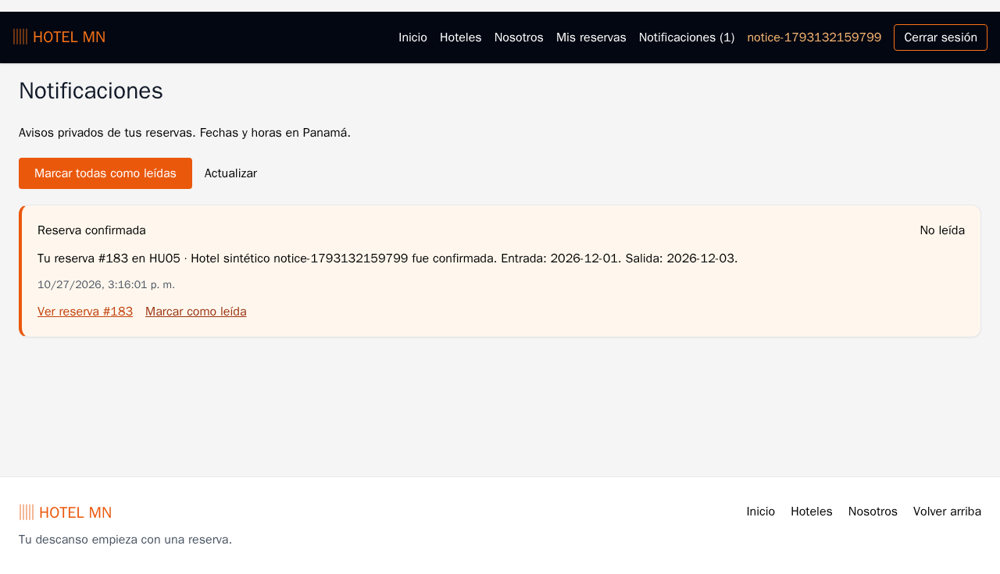
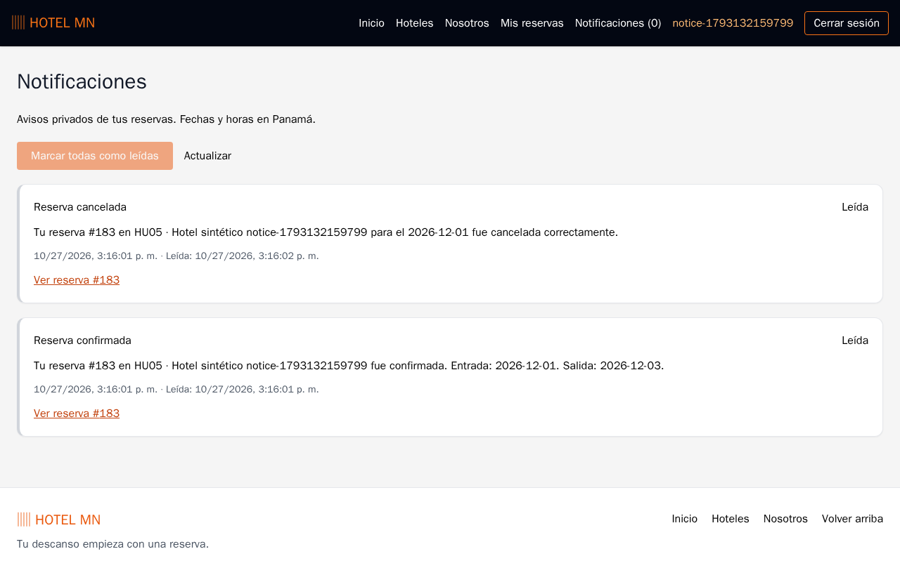
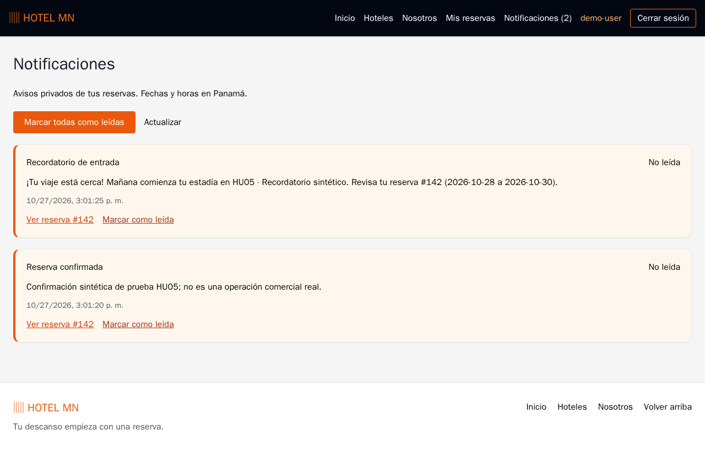
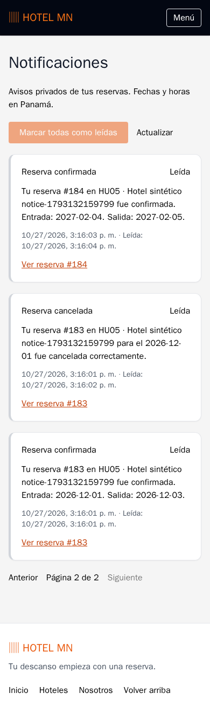

# HU-05 — Notificaciones y recordatorios internos

Issue real: [#8](https://github.com/yigpan29/hotel-reservation-system/issues/8).
Rama `feat/hu-05-notificaciones-reservas`, destino `base`, origen `9bd8d2e`.
La [auditoría previa](auditorias/HU05_NOTIFICACIONES.md) se completó en modo de
solo lectura antes de implementar. No se añade un sistema de autenticación.

## Arquitectura y transacciones

`ReservationServiceImp` invoca `NotificationService` después de persistir una
confirmación o registrar una cancelación nueva, dentro de la misma transacción.
Si la reserva o el aviso fallan, se revierte todo; no hay avisos huérfanos ni
callbacks en memoria que puedan perderse después del commit. Cancelar de nuevo
una reserva CANCELLED retorna antes de emitir otro aviso. Las reglas de reserva,
precio, disponibilidad y cancelación permanecen iguales.

`ReservationNotification`, `NotificationRepository`, DTOs y controlador contienen
solo lo necesario para el centro interno. Los mensajes guardan una instantánea
de nombre de hotel y fechas, junto al identificador de reserva. No se exponen
entidades, correos ni contraseñas en las respuestas.

V4 añade exclusivamente `reservation_notifications`: id, user_id FK, reservation_id
FK, type, hotel_name, start_date, end_date, message, created_at y read_at. Fechas de
creación/lectura son instantes con zona; read_at nulo significa no leída. Hay
restricciones de tipo, fechas e integridad y dos índices por usuario: orden reciente
y parcial para no leídas. V1, V2 y V3 no se modifican.

La salida puede faltar en una cancelación legacy: las reglas anteriores permiten
cancelarla. Se conserva ese comportamiento y el mensaje usa la entrada disponible.
Las confirmaciones nuevas y recordatorios sí requieren una salida posterior a la
entrada; no se inventan fechas ni se cambia la reserva para construir el aviso.

La unicidad **(reservation_id, type)** y `INSERT ... ON CONFLICT DO NOTHING`
respaldan la idempotencia en PostgreSQL, incluso entre instancias. Cada reserva
puede tener una confirmación, una cancelación y un recordatorio. Un reintento de
reserva idéntica sigue usando las reglas de solapamiento existentes, sin crear
una segunda operación ni un segundo aviso para la primera.

## Recordatorios

`ReminderService` usa el bean Clock existente interpretado en **America/Panama**:
mañana es el día calendario siguiente, no la hora actual más 24 horas. Selecciona
CONFIRMED con entrada mañana y estancia válida, bloquea cada reserva y vuelve a
comprobar fecha/estado antes de emitir. Cancelación y recordatorio se serializan
por ese bloqueo. Si el recordatorio ya se confirmó antes de cancelar, se conserva
como historial junto al posterior aviso de cancelación; no se emite otro después.

Solo son elegibles reservas que ya tengan una notificación CONFIRMED de HU-05.
Por decisión de diseño documentada antes de implementar, **las reservas anteriores,
incluso con entrada futura, no reciben recordatorios**. La migración no hace backfill.
Las reservas identificadas por reservation_demo_items se excluyen de nuevas
notificaciones y recordatorios; no se modifica ni elimina el historial de HU-03.
Una cancelación nueva y permitida de una reserva operativa anterior sí genera su
aviso de cancelación: es un evento nuevo, no una confirmación retrospectiva.

Horario predeterminado: **09:00 Panamá**, configurable mediante:

```text
HOTEL_REMINDERS_ENABLED=true
HOTEL_REMINDERS_CRON=0 0 9 * * *
```

También se revisa el día actual al terminar el arranque, para recuperar un reinicio
durante ese día. La restricción única impide duplicados. No se recuperan días
vencidos: si el sistema estuvo apagado durante todo el día anterior a una entrada,
no se envía un recordatorio tardío. Un error del proceso se registra sin datos
personales y no derriba la aplicación; la siguiente ejecución puede reintentar.
Los perfiles de mantenimiento catalog-panama, provision-admin y demand-history
no ejecutan este programador. No se usan servicios externos ni pagos.

## Seguridad y contrato HTTP

Sesiones HttpOnly y CSRF existentes. No hay parámetro userId ni privilegio ADMIN
para acceder a avisos de otro usuario. La identidad se toma de la sesión.

| Método/ruta | Resultado |
|---|---|
| GET `/api/notifications?page=0&size=20` | PageView de avisos propios, recientes primero; size 1–100 |
| GET `/api/notifications/unread-count` | `{unreadCount}` propio |
| POST `/api/notifications/{id}/read` | 204, lectura individual idempotente |
| POST `/api/notifications/read-all` | 204, marca únicamente las propias pendientes |

DTO: id, reservationId, type, hotelName, startDate, endDate, message, createdAt,
read y readAt. Tipos: CONFIRMED, CANCELLED, CHECK_IN_REMINDER. No hay borrado.
401 sin sesión, 403 sin CSRF, 404 aviso inexistente o ajeno (también para ADMIN),
400 paginación/formato inválidos. El primer read_at se conserva al repetir lectura.

## Frontend

Ruta protegida `/notifications`, acceso **Notificaciones (N)** en navegación
principal de escritorio y móvil. Listado de diez avisos por página, estados
leído/no leído, mensajes, fechas de Panamá y acciones individuales/todas.
Cada enlace abre `/reservations/{id}`, que reutiliza el endpoint y componente
existentes para consultar/cancelar la reserva sin duplicar su lógica.

El contador consulta PostgreSQL al iniciar sesión, recuperar foco, cada 30 segundos
y después de una operación de reserva/lectura exitosa. No simula notificaciones
en memoria. Las solicitudes se cancelan al cambiar de sesión; un fallo del contador
muestra `—`, nunca un cero falso. Historial, paginación, carga, vacío, errores y
sesión expirada tienen estados explícitos. No hay rediseño de hoteles o paneles.

## Compatibilidad autorizada con HU-03

El guardián de reversión de lotes rechaza FKs desconocidas por diseño. La nueva
relación V4 requería reconocer notificaciones; el operador **autorizó expresamente**
este ajuste mínimo: permitir la relación conocida, pero rechazar la reversión si
existe cualquier notificación dependiente de las reservas o su usuario técnico.
Se añadió una prueba de ese rechazo. No se modifican fórmula, consultas de demanda,
gráficos, estados ni datos de HU-03. Las demás relaciones desconocidas se siguen
rechazando. La reversión de lotes sin dependencias conserva su comportamiento.

## Pruebas y demostración reproducible

```powershell
# Revisa nombres/montajes y retira solo recursos del proyecto aislado anterior.
./tests/isolated/reset.ps1
./tests/isolated/run.ps1
```

El harness verifica PostgreSQL independiente, instalación V4 limpia y adopción
legacy, integridad/identidades, ausencia de backfill, rechazo de conexiones a
desarrollo, Maven clean verify, compatibilidad Flyway, TypeScript, ESLint, build
y Playwright. CI usa el mismo procedimiento en PR hacia base y workflow_dispatch.

Las pruebas JUnit usan un Clock controlado y el programador apagado para verificar
transacciones, cancelaciones, fechas, privacidad, CSRF, lectura, conteo y concurrencia.
La demostración de navegador usa cron cada cinco segundos **solo en backend-app
del compose aislado**. `notifications-demo.sql` exige hotel_test/usuario hotel_test:
crea una reserva sintética para demo-user y un aviso CONFIRMED de opt-in; el
programador real genera CHECK_IN_REMINDER. No se precarga ese recordatorio.
El escenario HU-03 existente permanece independiente y no recibe avisos.

Abrir `http://127.0.0.1:55173/notifications` después del harness con las credenciales
efímeras documentadas en compose.test.yaml. demo-user permite ver confirmación y
recordatorio sintéticos. El E2E adicional registra una cuenta temporal, confirma
desde la interfaz, lee el aviso, abre/cancela su reserva, marca todas, vuelve a
iniciar sesión y prueba paginación, errores y móvil. No se usan cuentas personales.

Reportes: `.local/isolated/<fecha>/`, `.local/isolated-artifacts/backend/` y
`.local/isolated-artifacts/e2e/`; CI los publica como artifacts. Las capturas para
documentación se seleccionan solo del entorno sintético aislado.

## Desarrollo persistente

No ejecutar automáticamente V4 sobre hotel-bd. Antes de desplegar: comprobar destino,
respaldar y verificar archivo privado, probar migración aislada y obtener autorización
específica. No repetir baseline. Tras migrar, actualizar solo backend con Hibernate
validate y Flyway automático desactivado; comprobar que no aparecen avisos históricos.
No crear usuarios ni reservas de demostración en desarrollo para probar HU-05.
El 27/10/2026 el operador autorizó específicamente V4 y actualización del backend.
Se verificó un respaldo privado custom/SHA-256, se restauró en PostgreSQL aislado
y se comprobó V4 conservando las ocho tablas originales. Después se aplicó solo
V4 en hotel-bd y se recreó únicamente backend, con Flyway automático false.
PostgreSQL y frontend no se reiniciaron; sus puertos y volumen se conservaron.
Tras arrancar: health UP, acceso anónimo a notificaciones 401, CSRF 200,
**cero notificaciones retroactivas**, 937 reservas y 936 etiquetas sintéticas.
Todas las filas originales conservan sus huellas. No se crearon usuarios ni
reservas de prueba en desarrollo ni se usó una cuenta personal en automatización.
Las sesiones anteriores del backend eran en memoria: volver a iniciar sesión.

## Resultados reales y evidencias

- Maven clean verify: **54 pruebas**, cero fallos; incluye tres de mensajes/calendario
  y nueve de integración HU-05, más las 42 anteriores.
- Compatibilidad Spring Boot/Flyway/PostgreSQL: **1 adicional**, satisfactoria.
- V4 limpia, adopción legacy, repetición, valores/identidades y no backfill: satisfactorios.
- TypeScript, ESLint y build: satisfactorios, repetidos con el frontend final.
- Playwright: **10/10**, incluidos los ocho flujos previos, reloj/programador real,
  privacidad, contador, lectura, paginación, persistencia, errores/sesión y móvil.
- Repetición de los dos escenarios HU-05 sin limpiar PostgreSQL: **2/2**.
- Copia privada de desarrollo restaurada/migrada: ocho tablas idénticas.

El primer intento tuvo dos errores del guardián de FK de HU-03: se corrigieron
con autorización específica y nueva regresión de dependencias. Una repetición
E2E detectó reservas de pruebas anteriores en habitaciones compartidas: ahora
cada ejecución prepara inventario exclusivo mediante ADMIN sintético aislado.
Se corrigió además el contraste CSS de tarjetas y el manejo de fechas nulas
legacy al abrir el enlace de reserva, sin cambiar sus reglas ni inventar fechas.
Los fallos conservan logs/capturas/trazas; no se ocultaron ni desactivaron reglas.

Logs locales: `.local/hu05-final.log`, `.local/hu05-legacy-ui-final.log`,
`.local/hu05-e2e-repeatable.log`, `.local/hu05-repeat-check.log` y reportes
`.local/isolated/20261027-145744/`. Los respaldos y huellas se excluyen de Git.
CI ejecuta el mismo harness; su resultado remoto vigente se enlaza desde el PR.

Estas imágenes contienen exclusivamente cuentas, inventario y reservas sintéticos
del entorno aislado; el recordatorio fue generado por el programador real:






La revisión humana, aprobación e integración a base permanecen a cargo del equipo.
